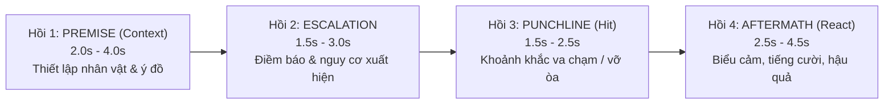

# 🎭 VisionCut Comedy Timing (`comedy-timing`)

Manages comedic, dramatic, and high-retention timing for funny moments, fail compilations, viral incident shorts, and prank videos.

---

## ⚡ 4-BEAT NARRATIVE ARCHITECTURE (CẤU TRÚC 4 HỒI CHUẨN)

Mọi tình huống hài hước hoặc kịch tính (incident/fail/joke) bắt buộc phải tuân theo cấu trúc 4 hồi để bảo toàn trọn vẹn sự tương phản và tiếng cười:

| Pha Kịch Tính | Thời Lượng Chuẩn | Trần Thời Lượng Tối Đa | Mô Tả & Ranh Giới Cắt |
| :--- | :---: | :---: | :--- |
| **`Hồi 1: Premise / Setup`** | **2.0s – 3.5s** | **Tối đa 4.0s** | **Bảo toàn Ngữ cảnh (Context):** Điểm `IN` bắt đầu từ khoảnh khắc hành động có chủ đích xuất hiện (nhân vật đang làm gì, ở đâu, định làm gì). Bỏ đoạn máy rung lắc, lia chưa định hình. |
| **`Hồi 2: Escalation / Anticipation`** | **1.5s – 3.0s** | **Tối đa 3.5s** | **Điềm báo:** Tích lũy căng thẳng hoặc sự vụng về bắt đầu lộ ra. Não bộ khán giả hình thành dự đoán cú ngã/trò đùa. |
| **`Hồi 3: Punchline / Climax`** | **1.5s – 2.5s** | **Tối đa 3.0s** | **Khoảnh khắc va chạm / bất ngờ:** Đúng thời điểm sự việc vỡ lở, cú ngã, trò đùa nổ tung. |
| **`Hồi 4: Aftermath / Reaction`** | **2.0s – 4.0s** | **Tối đa 4.5s** | **Giữ trọn tiếng cười:** Điểm `OUT` chỉ được cắt sau khi biểu cảm (ngơ ngác, cười ngượng, la hét) lắng xuống (`Reaction Settled`). Tối thiểu 1.5s sau va chạm. Cấm cắt cụt ngang phản ứng! |
| **TỔNG INCIDENT (1 Nhịp)** | **8.0s – 14.0s** | **Tối đa 15.0s** | Toàn bộ 1 tình huống cô đọng trọn vẹn câu chuyện từ nguyên nhân đến kết quả. |

---

## 🎯 4 QUY TẮC BẮT BUỘC (CRITICAL EDITORIAL LAWS)

### 1. Luật Bảo Toàn Ngữ Cảnh (Context Preservation Rule)
- **Tuyệt đối cấm cắt ngang hông:** Không bao giờ snap máy móc một cửa sổ đối xứng vài giây quanh Action Peak (`Peak - 2s`).
- Khán giả phải **hiểu được tiền đề (Premise)** trong 2-3 giây đầu tiên của clip: Tại sao người này lại ở đây? Hành động này có gì kỳ lạ? Cắt mất Context thì cú ngã chỉ là tai nạn vô nghĩa, không thể gây cười.

### 2. Cơ Chế "Dead-Middle" Micro-Cut (Cắt bỏ khúc giữa, giữ trọn đầu đuôi)
- Khi một video có:
  - Setup đắt giá ở đầu (0s - 3s).
  - Khoảng chờ lê thê vô nghĩa ở giữa (4s - 25s: nhân vật đứng suy nghĩ, loay hoay, không có chuyển biến).
  - Climax và Reaction bùng nổ ở đuôi (26s - 32s).
- **Hành vi nghiêm cấm:** Vứt bỏ giây 0-3s và chỉ lấy từ giây 24-30 (gây mất Context).
- **Quy chuẩn đúng:** Áp dụng **Micro-Cut / Jump-cut nội bộ**:
  - Giữ lại Setup (0s - 3s).
  - Cắt bỏ hoàn toàn Dead Middle (4s - 24s).
  - Nối tiếp vào Climax & Reaction (24s - 32s).

### 3. Quy Tắc Reaction Hold (Bảo Vệ Hậu Quả & Tiếng Cười)
- Tiếng cười của khán giả luôn có độ trễ: Sau cú hit (Climax), não bộ cần $0.5\text{s}$ nhận diện và $1.5\text{s} - 3.0\text{s}$ để bật cười theo biểu cảm nhân vật.
- Cắt clip quá sớm ngay khi vừa tiếp đất là "bóp nghẹt tiếng cười". Phải giữ cho đến khi nhân vật hoàn tất phản ứng hoặc cắt sang một góc máy phản ứng khác.

### 4. Incident Bundling (Gom Cụm Diễn Biến)
- Nếu một sự cố có Replay góc 2, góc cận phản ứng, hoặc hậu quả liên hoàn: Gom toàn bộ vào một `Incident Bundle` chiếu liền mạch, mỗi góc cắt ultra-tight 2-3s.
