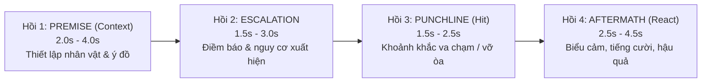

# 🎭 VisionCut Comedy Timing (`comedy-timing`)

Manages comedic, dramatic, and high-retention timing for funny moments, fail compilations, viral incident shorts, and prank videos.

---

## ⚡ 4-BEAT NARRATIVE ARCHITECTURE (CẤU TRÚC 4 HỒI CHUẨN)

Mọi tình huống hài hước hoặc kịch tính (incident/fail/joke) bắt buộc phải tuân theo cấu trúc 4 hồi để bảo toàn trọn vẹn sự tương phản và tiếng cười:

| Pha Kịch Tính | Thời Lượng Chuẩn | Trần Thời Lượng Tối Đa | Mô Tả & Ranh Giới Cắt |
| :--- | :---: | :---: | :--- |
| **`Hồi 1: Premise / Setup`** | **2.0s – 3.5s** | **Tối đa 4.0s** | **Bảo toàn Ngữ cảnh (Context):** Điểm `IN` bắt đầu từ khoảnh khắc hành động có chủ đích xuất hiện (nhân vật đang làm gì, ở đâu, định làm gì). Bỏ đoạn máy rung lắc, lia chưa định hình. |
| **`Hồi 2: Escalation / Anticipation`** | **1.5s – 3.0s** | **Tối đa 3.5s** | **Điềm báo:** Tích lũy căng thẳng hoặc sự vụng về bắt đầu lộ ra. Não bộ khán giả hình thành dự đoán cú ngã/trò đùa. |
| **`Hồi 3: Punchline / Climax`** | **1.5s – 2.5s** | **Tối đa 3.0s** | **Khoảnh khắc va chạm / bất ngờ:** Đúng thời điểm sự việc vỡ lở, cú ngã, trò đùa nổ tung. |
| **`Hồi 4: Aftermath / Reaction`** | **2.0s – 4.0s** | **Tối đa 4.5s** | **Giữ trọn tiếng cười:** Điểm `OUT` chỉ được cắt sau khi biểu cảm (ngơ ngác, cười ngượng, la hét) lắng xuống (`Reaction Settled`). Tối thiểu 1.5s sau va chạm. Cấm cắt cụt ngang phản ứng! |
| **TỔNG INCIDENT (1 Nhịp)** | **8.0s – 14.0s** | **Tối đa 15.0s** | Toàn bộ 1 tình huống cô đọng trọn vẹn câu chuyện từ nguyên nhân đến kết quả. |

---

## 🎯 5 QUY TẮC BẮT BUỘC (CRITICAL EDITORIAL LAWS)

### 0. Luật Cô Lập Ranh Giới Cảnh (Hard Scene Cut Isolation — Bắt Buộc Bước 1)
- **Thực tế nguồn footage (`source` / compilation rips):** Các file cắt thô từ video tổng hợp thường bị **dính 2s–5s của clip trước ở đầu** và **2s–5s của clip tiếp theo ở cuối** (hoặc bị lẫn frame chuyển cảnh ở mép cuối trong `Bonk-script`).
- **Quy trình bắt buộc trước khi tính nhịp hài:**
  1. Quét phát hiện **Hard Scene Cuts (vết chuyển cảnh cứng)** bên trong từng file bằng độ tương quan không gian + biểu đồ màu vùng trung tâm (`center-crop HSV histogram + spatial correlation`), tuyệt đối không dùng `argmax(absdiff)` thô (vì `argmax(absdiff)` sẽ luôn bắt nhầm vào đúng vết chuyển cảnh giữa 2 video khác nhau!).
  2. Loại bỏ hoàn toàn phân đoạn thừa của clip trước ở đầu (`0.0s -> cut_1`) và phân đoạn thừa của clip sau ở cuối (`cut_last -> dur`), cô lập chính xác **cảnh mục tiêu ở giữa** (`[scene_start, scene_end]`) kèm biên an toàn `±0.08s`.
  3. **Kiểm duyệt bằng mắt AI (`view_file` trên Contact Sheets):** Luôn kết xuất bảng lưới thumbnail (Contact Sheets) cho toàn bộ clip với khung viền xanh đánh dấu đoạn giữ lại `[in_pt -> out_pt]` và dùng `view_file` để mắt AI xác nhận 100% không bị lọt frame của cảnh khác.

### 1. Luật Một Đoạn Liền Mạch & Bảo Toàn Ngữ Cảnh (Single Continuous Slice & Context Preservation)
- **Mỗi tình huống hài là 1 đoạn cắt liền mạch duy nhất (`[in_pt -> out_pt]`, dài `4.0s – 11.0s`) nằm trọn trong `[scene_start, scene_end]`:**
  - Nếu cảnh cô lập `[scene_start, scene_end]` đã ngắn gọn ($\le 9.0\text{s}$): Giữ nguyên vẹn toàn bộ cảnh cô lập đó (`[scene_start, scene_end]`).
  - Nếu cảnh cô lập dài ($> 9.0\text{s}$): Tìm điểm cao trào (`peak_t`) **bên trong phạm vi của riêng cảnh đó** và lấy 1 đoạn liền mạch từ `max(scene_start, peak_t - 4.0s)` đến `min(scene_end, peak_t + 3.5s)`.
- **Tuyệt đối cấm cắt ngang hông:** Không bao giờ lấy cửa sổ quá hẹp (`Peak - 1.5s`) làm mất tiền đề (Premise) của cảnh.

### 2. Cấm Cắt Nhảy Cóc Máy Móc `[0.0s -> 3.0s]` (No Blind Jump-Cuts)
- **Hành vi nghiêm cấm:** Tuyệt đối KHÔNG tự động cắt lấy `[0.0s -> 3.0s]` ở đầu file rồi nối nhảy cóc (jump-cut) tới `[peak - 2s -> peak + 3s]`. Trong các file rip từ compilation, `0.0s -> 3.0s` là cảnh của video khác phía trước, còn việc cắt khúc giữa của một cú máy liền mạch sẽ tạo ra vết giật hình (jump-cut) làm đứt mạch xem.
- Chỉ tách thành 2 clip riêng biệt khi bên trong 1 file thực sự chứa **2 tình huống hài độc lập hoàn chỉnh** được kiểm chứng qua Contact Sheet.

### 3. Quy Tắc Reaction Hold (Bảo Vệ Hậu Quả & Tiếng Cười)
- Tiếng cười của khán giả luôn có độ trễ: Sau cú hit (Climax), não bộ cần $0.5\text{s}$ nhận diện và $1.5\text{s} - 3.5\text{s}$ để bật cười theo biểu cảm nhân vật.
- Cắt clip quá sớm ngay khi vừa tiếp đất là "bóp nghẹt tiếng cười". Phải giữ cho đến khi nhân vật hoàn tất phản ứng (nhưng tuyệt đối phải cắt **trước** vết chuyển cảnh sang clip tiếp theo `scene_end`).

### 4. Incident Bundling (Gom Cụm Diễn Biến)
- Nếu một sự cố có Replay góc 2 hoặc góc cận phản ứng của cùng một sự việc: Giữ liền mạch trong cùng khung `[in_pt -> out_pt]` của cảnh đó.

---

## 🧠 KHUNG LẬP LUẬN DỰNG PHIM (VIDEO EDITOR REASONING FRAMEWORK)

Kết hợp giữa **Tư duy kể chuyện của Người dựng phim (Human Reasoning)** và **Khả năng suy luận đa bước của AI (AI Video Editing Reasoning)**:

### Phần 1: Tư Duy Lập Luận Của Người Dựng Phim (Human Editorial Reasoning)
1. **Logic Câu Chuyện & Nhịp Điệu (Narrative Logic & Pacing):**
   - Dựng hài/kịch tính là dựng **quan hệ Nhân – Quả (Causality)** chứ không phải cắt theo biên độ chuyển động vật lý.
   - Nhịp cắt phải dẫn dắt cảm xúc: Thiết lập kỳ vọng bình thường $\to$ Xuất hiện dấu hiệu bất ổn $\to$ Cú lật tẩy/va chạm (Punchline) $\to$ Khoảng thở cho tiếng cười (Reaction Hold). Áp dụng linh hoạt J-cut / L-cut hoặc Match-cut khi chuyển giữa các góc máy.
2. **Hiểu Ý Đồ Ẩn Dụ & Sự Tương Phản (Subtext & Comedic Contrast):**
   - Tiếng cười sinh ra từ **độ chênh giữa Kỳ vọng (Setup tự tin/nghiêm túc) và Thực tế (Payoff thất bại/bất ngờ)**.
   - Nếu cắt mất phần nhân vật đang tự tin chuẩn bị (Setup), cú ngã chỉ còn là một va chạm vật lý đơn thuần, mất toàn bộ tính hài hước ẩn dụ.
3. **Xử Lý Sự Cố Raccord / Tính Liên Tục (Continuity & Raccord Guard):**
   - **Raccord Không gian / Cảnh:** Tuyệt đối không để lọt dù chỉ 1–2 frame của cảnh trước hoặc cảnh sau (compilation bleed) ở mép cắt.
   - **Raccord Hành động / Thời gian:** Không bao giờ cắt bỏ khúc giữa của một cú máy đơn (single-take) đang chuyển động liên tục, vì sẽ tạo ra lỗi nhảy hình (jump-cut) làm nhân vật bị "dịch chuyển tức thời".
   - **Raccord Chuyển động giả (Camera Drop Rejection):** Phân biệt được giữa *chuyển động của sự kiện* và *chuyển động rác của camera* (ví dụ: sau khi xe trượt ngã, người quay phim hạ máy quay nhìn xuống đất/tuyết trắng 10 giây — đoạn nhìn xuống đất phải được cắt bỏ dù lúc hạ máy có `motion` rất lớn).
4. **Lập Luận Chọn Cảnh (Shot Selection Reasoning):**
   - Khi một file nguồn chứa nhiều cảnh nối tiếp (compilation rip), phải suy luận để loại bỏ các mảnh cảnh cụt đầu (mất Setup) ở đầu file và cụt đuôi (mất Payoff) ở cuối file, chọn đúng cảnh ở giữa có cấu trúc Nhân – Quả hoàn chỉnh nhất.

### Phần 2: Khả Năng Lập Luận Của AI Trong Dựng Phim (AI Video Editing Reasoning)
1. **Lập Luận Ẩn Ý & Đa Bước (Implicit & Multi-Hop Reasoning):**
   - Thay vì dùng 1 hàm toán học đơn bước (`argmax(absdiff)`), AI bắt buộc thực hiện chuỗi suy luận 3 bước (3-Hop Reasoning):
     - **Hop 1 (Scene Boundary Segmentation):** Phân tách ranh giới các cảnh độc lập trong file (dựa trên tương quan không gian + biểu đồ màu vùng trung tâm).
     - **Hop 2 (Causal Event Localization):** Bên trong cảnh mục tiêu, xác định đâu là khởi đầu hành động có chủ đích (`IN`), đâu là đỉnh điểm biến cố (`Climax`), và đâu là kết thúc phản ứng thực sự (`OUT` — loại bỏ phần camera quay vào khoảng không sau biến cố).
     - **Hop 3 (Visual Raccord Verification):** Kiểm tra trực quan trên Contact Sheet xem mép `IN` và `OUT` có bị dính cảnh lạ hay cắt cụt cảm xúc không.
2. **Định Vị Chỉ Dẫn Trong Không-Thời Gian (Temporal & Spatial Instruction Grounding):**
   - **Spatial Grounding:** Khi phân tích khung hình, định vị vào vùng nội dung trung tâm (loại bỏ hai dải mờ pillarbox 9:16 hoặc watermark tĩnh) để không bị đánh lừa bởi viền khung hình.
   - **Temporal Grounding:** Neo mọi quyết định cắt vào mốc thời gian thực tế (`[in_sec -> out_sec]`) đã được đối chiếu qua keyframe/filmstrip (`view_file`), không suy đoán mò.
3. **Phân Biệt Chỉnh Sửa Hành Động (Action-Based) vs. Chỉnh Sửa Lập Luận (Reasoning-Based):**
   - **Chỉnh sửa Hành động (Action Edit — Cấp thấp):** Thực thi lệnh cơ học cứng nhắc (*"Lấy 3s đầu nối với 5s cuối"*, *"Lấy $\pm 3\text{s}$ quanh frame lệch màu lớn nhất"*). Cách này thất bại ngay khi gặp footage thực tế không đồng nhất.
   - **Chỉnh sửa Lập luận (Reasoning Edit — Cấp cao):** Hiểu mục tiêu biên tập (*"Làm nổi bật tình huống hài hước trọn vẹn"*), tự động chẩn đoán đặc thù của từng file (file đơn cảnh ngắn, file đơn cảnh dài có đoạn chết ở cuối, hay file ghép từ compilation) để đưa ra quyết định cắt `[in_sec -> out_sec]` phù hợp nhất với từng trường hợp.
