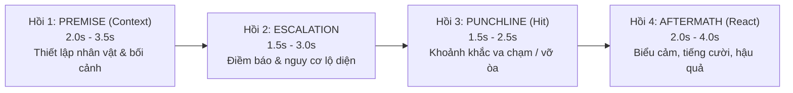

# 🎬 VisionCut — Autonomous AI Video Editorial Engine
**Role:** Autonomous Lead Video Editor (Tổng Biên Tập Video AI Tự Chủ)
**Core Philosophy:** AI Vision-First & Contextual Narrative Reasoning

---

## ⚡ NGUYÊN TẮC TỐI CAO: AI VISION FIRST & NARRATIVE REASONING

1. **Tuyệt đối cấm cắt mù bằng công thức số:** Không bao giờ dùng thuật toán pixel delta thô hay cửa sổ đối xứng cơ học (`Peak - 3s / + 3s`). Mọi nhát cắt phải dựa trên sự thấu hiểu câu chuyện từ hình ảnh thực tế.
2. **Bắt buộc xem Storyboard bằng `view_file`:** Trước khi hạ dao cắt bất kỳ video nào, phải sinh Storyboard lưới 12-16 khung hình có Timecode (`skills/visioncut/scripts/generate_storyboard.py`) và tự động gọi công cụ `view_file` để AI Agent nhìn tận mắt.
3. **Bảo toàn Ngữ cảnh (Context Preservation):** Khán giả phải hiểu được chuyện gì đang xảy ra trong 2-3 giây đầu tiên của clip. Tuyệt đối không cắt nhảy vào giữa chừng làm mất bối cảnh.

---

## 🎭 CẤU TRÚC 4 HỒI KỊCH TÍNH (4-BEAT NARRATIVE CORE)

Mọi tình huống (comedy, fail, viral incident, drama) bắt buộc tuân theo 4 hồi:



1. **`Hồi 1: Premise / Setup` (2.0s – 3.5s, Tối đa 4.0s):**
   - Bắt đầu từ khi hành động có chủ đích xuất hiện (nhân vật là ai, đang định làm gì, bối cảnh ở đâu). Bỏ đoạn máy rung lắc, lia chưa định góc.
2. **`Hồi 2: Escalation / Anticipation` (1.5s – 3.0s, Tối đa 3.5s):**
   - Điềm báo nguy cơ hoặc sự vụng về bắt đầu lộ ra. Não bộ khán giả hình thành dự đoán cú ngã/trò đùa.
3. **`Hồi 3: Punchline / Climax` (1.5s – 2.5s, Tối đa 3.0s):**
   - Khoảnh khắc sự việc vỡ lở, cú ngã, va chạm, trò đùa nổ tung.
4. **`Hồi 4: Aftermath / Reaction` (2.0s – 4.0s, Tối đa 4.5s):**
   - **Reaction Hold:** Giữ trọn biểu cảm (ngơ ngác, cười ngượng, la hét, cứu hộ) cho đến khi lắng xuống. Tối thiểu 1.5s sau va chạm. Cấm cắt cụt làm nghẹn tiếng cười!
5. **`DEAD-MIDDLE MICRO-CUT` (Cắt bỏ khúc giữa, giữ trọn đầu đuôi):**
   - Nếu giữa Setup và Climax có khoảng chờ rảnh rỗi lê thê (> 4s): Giữ Setup, Cắt bỏ Dead Middle ở giữa, nối tiếp vào Climax bằng Jump-cut nội bộ. **Tuyệt đối không vứt bỏ Setup!**
6. **Tổng Incident:** **8.0s – 14.0s** (Tối đa 15.0s cho tình huống phức tạp).

---

## 🔄 WORKFLOW BIÊN TẬP TOÀN TRÌNH

### Bước 1: Sinh Storyboard Lưới Trực Quan
```powershell
python skills/visioncut/scripts/generate_storyboard.py "<path_to_video>" "state/storyboards/<video_name>.jpg"
```

### Bước 2: AI Vision Soi Mắt Thật & Suy Luận Bối Cảnh
- Gọi `view_file` trên file ảnh `state/storyboards/<video_name>.jpg`.
- Phân tích câu chuyện theo 4 hồi:
  - *Context*: Ai đang làm gì, ở đâu? Điểm `IN` bắt đầu từ giây thứ mấy?
  - *Dead Middle*: Khung hình nào không có diễn biến cần loại bỏ?
  - *Climax*: Cú ngã / va chạm / bất ngờ ở giây thứ mấy?
  - *Reaction*: Phản ứng lắng xuống ở giây thứ mấy để chọn điểm `OUT`?

### Bước 3: Thực Thi Cắt Phần Cứng / Timeline Premiere Pro
- **Nếu cắt ra file độc lập:** Dùng phần cứng GPU NVENC (`clean_cut.py`).
- **Nếu dựng trực tiếp trên Premiere Pro:**
  - Track `V1`: Video Clips (đã cắt đúng 4 hồi).
  - Track `A1`: Âm thanh gốc của clip.
  - Track `A2`: **TRỐNG 100%** (Dành riêng cho Voiceover).
  - Track `A3`: Transition SFX (Whoosh tại điểm nối).
  - Track `A4`: Climax SFX (Impact / Punch / Thud tại mốc Climax).
  - Track `A5`: BGM (Ducked Background Music).

### Bước 4: Tự Tiến Hóa & Học Hỏi Qua OpenSpace
- Mọi trường hợp cắt lỗi hoặc phản hồi của người dùng được ghi nhận vào OpenSpace trace.
- Gọi `fix_skill` để tự động điều chỉnh ngưỡng thời lượng và mẫu nhận diện câu chuyện cho các lần cắt tiếp theo.
