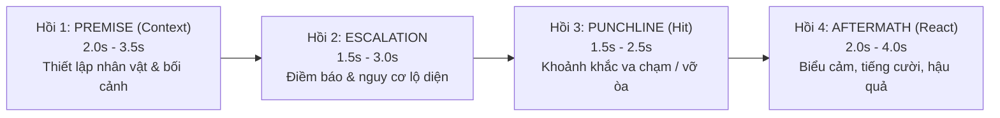

# 🎬 VisionCut — Autonomous AI Video Editorial Engine
**Role:** Autonomous Lead Video Editor (Tổng Biên Tập Video AI Tự Chủ)
**Core Philosophy:** AI Vision-First & Contextual Narrative Reasoning

---

## ⚡ NGUYÊN TẮC TỐI CAO: AI VISION FIRST & NARRATIVE REASONING

1. **Tuyệt đối cấm cắt mù bằng công thức số:** Không bao giờ dùng thuật toán pixel delta thô hay cửa sổ đối xứng cơ học (`Peak - 3s / + 3s`). Mọi nhát cắt phải dựa trên sự thấu hiểu câu chuyện từ hình ảnh thực tế.
2. **Bắt buộc xem Storyboard bằng `view_file`:** Trước khi hạ dao cắt bất kỳ video nào, phải sinh Storyboard lưới 12-16 khung hình có Timecode (`skills/visioncut/scripts/generate_storyboard.py`) và tự động gọi công cụ `view_file` để AI Agent nhìn tận mắt.
3. **Bảo toàn Ngữ cảnh (Context Preservation):** Khán giả phải hiểu được chuyện gì đang xảy ra trong 2-3 giây đầu tiên của clip. Tuyệt đối không cắt nhảy vào giữa chừng làm mất bối cảnh.

---

## 🎭 CẤU TRÚC 4 HỒI KỊCH TÍNH (4-BEAT NARRATIVE CORE)

Mọi tình huống (comedy, fail, viral incident, drama) bắt buộc tuân theo 4 hồi:



1. **`Hồi 1: Premise / Setup` (2.0s – 3.5s, Tối đa 4.0s):**
   - Bắt đầu từ khi hành động có chủ đích xuất hiện (nhân vật là ai, đang định làm gì, bối cảnh ở đâu). Bỏ đoạn máy rung lắc, lia chưa định góc.
2. **`Hồi 2: Escalation / Anticipation` (1.5s – 3.0s, Tối đa 3.5s):**
   - Điềm báo nguy cơ hoặc sự vụng về bắt đầu lộ ra. Não bộ khán giả hình thành dự đoán cú ngã/trò đùa.
3. **`Hồi 3: Punchline / Climax` (1.5s – 2.5s, Tối đa 3.0s):**
   - Khoảnh khắc sự việc vỡ lở, cú ngã, va chạm, trò đùa nổ tung.
4. **`Hồi 4: Aftermath / Reaction` (2.0s – 4.0s, Tối đa 4.5s):**
   - **Reaction Hold:** Giữ trọn biểu cảm (ngơ ngác, cười ngượng, la hét, cứu hộ) cho đến khi lắng xuống. Tối thiểu 1.5s sau va chạm. Cấm cắt cụt làm nghẹn tiếng cười!
5. **`DEAD-MIDDLE MICRO-CUT` (Cắt bỏ khúc giữa, giữ trọn đầu đuôi):**
   - Nếu giữa Setup và Climax có khoảng chờ rảnh rỗi lê thê (> 4s): Giữ Setup, Cắt bỏ Dead Middle ở giữa, nối tiếp vào Climax bằng Jump-cut nội bộ. **Tuyệt đối không vứt bỏ Setup!**
6. **Tổng Incident:** **8.0s – 14.0s** (Tối đa 15.0s cho tình huống phức tạp).

---

## 🔄 WORKFLOW BIÊN TẬP TOÀN TRÌNH

### Bước 1: Sinh Storyboard Lưới Trực Quan
```powershell
python skills/visioncut/scripts/generate_storyboard.py "<path_to_video>" "state/storyboards/<video_name>.jpg"
```

### Bước 2: AI Vision Soi Mắt Thật & Suy Luận Bối Cảnh
- Gọi `view_file` trên file ảnh `state/storyboards/<video_name>.jpg`.
- Phân tích câu chuyện theo 4 hồi:
  - *Context*: Ai đang làm gì, ở đâu? Điểm `IN` bắt đầu từ giây thứ mấy?
  - *Dead Middle*: Khung hình nào không có diễn biến cần loại bỏ?
  - *Climax*: Cú ngã / va chạm / bất ngờ ở giây thứ mấy?
  - *Reaction*: Phản ứng lắng xuống ở giây thứ mấy để chọn điểm `OUT`?

### Bước 3: Thực Thi Cắt Phần Cứng / Timeline Premiere Pro
- **Nếu cắt ra file độc lập:** Dùng phần cứng GPU NVENC (`clean_cut.py`).
- **Nếu dựng trực tiếp trên Premiere Pro:**
  - Track `V1`: Video Clips (đã cắt đúng 4 hồi).
  - Track `A1`: Âm thanh gốc của clip.
  - Track `A2`: **TRỐNG 100%** (Dành riêng cho Voiceover).
  - Track `A3`: Transition SFX (Whoosh tại điểm nối).
  - Track `A4`: Climax SFX (Impact / Punch / Thud tại mốc Climax).
  - Track `A5`: BGM (Ducked Background Music).

### Bước 4: Tối Ưu Hóa Tốc Độ Theo Kênh (`channel_profiles.json` & `premiere-cli` Fast Batch)
Đọc cấu hình kênh tại `E:\.agents\skills\visioncut\resources\channel_profiles.json`:
1. **Chống cắt nhầm Sequence / Project:** Luôn truyền tường minh `sequenceName` (ví dụ `"kb105"`) vào mọi lệnh `premiere-cli`. Khi mở nhiều project (`app.projects`), `set-item-in-out` và `add-to-timeline` tự động quét qua toàn bộ `app.projects[p].rootItem`.
2. **Bảo toàn tuyệt đối đồng bộ `V1` + `A1` (Zero Audio Drift):**
   - Cấm dùng `seq.overwriteClip` đơn lẻ cho subclip vì Premiere 2026 bỏ qua `inPoint`/`outPoint` của projectItem và ghi đè toàn bộ thời lượng gốc lên `A1`.
   - Khi cắt cảnh trên timeline: gán đồng thời `inPoint`, `outPoint`, `start`, `end` cho cả `vClip` (`V1`) và `aClip` (`A1`) trong cùng một nhịp, sau đó chạy `check-sequence-sync` để xác nhận `drift = 0`.
3. **Cắt bỏ nền mờ & Che logo tốc độ cao (< 15 giây cho 100 clip):**
   - Gửi batch trực tiếp qua HTTP bridge `http://127.0.0.1:47823/command` của `premiere-cli` (thay vì tạo hàng trăm subprocess `python.exe` rời rạc).
   - **Cắt bỏ nền mờ (`Crop` `AE.ADBE AECrop` trên `V1`):** Áp `Crop` (`Left` / `Right` `15.5% – 35%`) trực tiếp lên clip `V1` có viền mờ hai bên — tự động cắt bay toàn bộ logo nằm ở dải nền mờ (`LA`, `FAILARMY`, `TMAX`, `REC`, `MEC`, `22`).
   - **Chuẩn hóa `Scale` & Đẩy logo sát mép (`V1`):** Tính `fit_scale = min(1920/w, 1080/h) * 100`. Nếu clip có watermark sát mép trên/dưới (`ViralHog`, `DUMPERT`, `ring`, `TMAX`, `LA`, `Reddit`), nhân thêm `~1.15x` (`1920x1080 -> 115%`, `1080x1920 -> 65%`, `720x1280 -> 95%`, `1280x720 -> 168%`) để đẩy watermark ra ngoài khung `1080p` (đúng chuẩn `kb102`).
   - **Che logo nằm sâu trong hình (`Track V2` Shield):** Gọi `set-item-in-out` khớp `inPointSeconds`/`outPointSeconds` của `V1`, gọi `add-to-timeline` lên `V2` (`trackIndex: 1`, tự động dọn audio thừa trên `A2` mà không chạm vào `A1`), đồng bộ `Scale`, rồi áp `Gaussian Blur` (`AE.Impact_Blur_FX`, `Amount: 20`) + `Crop` (`Edge Feather: 15`) khoanh đúng tọa độ logo.

### Bước 4.2: Quy Trình Dựng Tập Kênh ITV 2 Phần & Hoàn Thiện 10-Track Studio (`kb100..kb110`)
1. **Cấu Trúc Xếp Clip 3 Khối Chuẩn ITV (`85–90 clips`, tổng thời lượng `7m45s – 9m30s`):**
   - **Khối 1 — Phần 1 (`source/itv.kb*.mp4`, ~18–20 clips):** Giữ nguyên đúng thứ tự đánh số kịch bản (`1 -> 20`; nếu có cặp `X-2` và `X` thì `X-2` đứng trước `X`), cắt sạch mọi đoạn bleed chuyển cảnh ở đầu/cuối clip.
   - **Khối 2 — Phần 2 Có Tiếng (`ITV-Moments-script-*/*.mp4` có `peak_db > -24 dB`):** Xếp theo thứ tự số tăng dần (`01 -> 70`), cắt chuẩn 4-Beat (`Premise -> Escalation -> Punchline -> Aftermath`) và dùng `Dead-Middle Micro-Cut` cho các clip chờ dài.
   - **Khối 3 — Phần 2 Montage Câm (`ITV-Moments-script-*/*.mp4` bị câm hoặc `peak_db <= -25 dB`, 7–11 clips cuối timeline):**
     - Gom toàn bộ các clip câm ở Phần 2 về cuối sequence (nếu file gốc thiếu stream audio thì mux thêm stereo silent stream trước khi import để đồng bộ 1:1 khi cắt, sau đó khi hoàn thiện 10-track thì gỡ bỏ các `A1` câm trong vùng có BGM).
     - **Nhạc nền BGM (`Track A5`) CHỈ đặt vào các đoạn clip không có âm thanh gốc:** Chọn nhạc nền đúng nhịp (`Kazoom`, `Angel Lover`, `Greaser`, `ChaCha Fontanez`, `Brain Trust`, `City Blocks`, `Standoff`), đặt trên `Track A5` phủ kín các khoảng clip câm sao cho `Coverage(A1) + Coverage(A5) = 100%` (tuyệt đối không chèn BGM đè lên tiếng hiện trường gốc của các clip có tiếng).

2. **Quy Trình Bắt Buộc Khi Đặt Emoji Che Va Chạm (`Track V4`) & Mask Che Logo (`Track V2`/`V3`) — CẤM ĐOÁN MÙ TỌA ĐỘ:**
   - **Tuyệt đối cấm** đoán thời điểm va chạm hoặc tọa độ `(x, y)` từ bảng thumbnail thô chưa qua `Scale`/`Crop`, và **tuyệt đối cấm** dùng OpenCV vẽ giả lập thay cho hình xuất thật từ Premiere Pro!
   - **Quy trình 4 bước `premiere-cli` + AI Vision (`view_file`) bắt buộc:**
     1. *Dò chính xác thời điểm va chạm bằng dải frame dày đặc (`0.08s – 0.10s/frame`):* Xuất dải frame quanh pha va chạm và gọi `view_file` để chốt chính xác frame bắt đầu chạm (`t_hit_start`) và kết thúc (`t_hit_end`, kéo dài `0.35s – 0.50s`). Không bao giờ đặt emoji sớm khi nhân vật vẫn đang đứng/di chuyển trước lúc va chạm!
     2. *Chọn đúng Emoji theo bộ phận & ngữ cảnh vật lý (`E:\Video Asset\Animated emojis` / `E:\ITV\rerender\emoji`):*
        - `🙈` (`512 (1).gif` — `monkey_eyes`): Chỉ dùng khi va đập trực tiếp vào **vùng nhạy cảm / hạ bộ (groin/crotch)** (ví dụ: trượt ván/nhảy cầu đập háng vào thanh sắt/thành hồ).
        - `😵‍💫` (`mnhat_emoji_37.gif` — `dizzy`): Đập thẳng vào **đầu / mặt / cổ** gây choáng váng.
        - `💥` (`512 (4).gif` — `bang`): Nổ, sập đồ vật nặng, đập lưng/ngực cực mạnh.
        - `💨⭐` (`512 (7).gif` — `fight_cloud`): Va chạm hỗn loạn nhiều người/vật thể, sập giàn/thang, lật xe/thuyền.
        - `😹` (`512 (6).gif` — `laugh_cat`) & `🐱` (`512 (5).gif` — `orange_cat`): Trượt ngã hài hước, quê độ.
     3. *Đọc tọa độ trên khung `1920x1080` đã áp `Scale` + `Crop` và đặt `InPoint = 0`:* Xuất 4 frame tại `t0, t1, t2, t3` từ sequence `1920x1080` (qua `premiere-cli export-frame` hoặc frame đã áp đúng `Scale`/`Crop` kèm lưới tọa độ `[0.0 .. 1.0]`), gọi `view_file` đọc tọa độ `(x, y)` của đúng bộ phận bị va đập tại cả 4 mốc. Đặt `InPoint = 0` cho clip Emoji trên `Track V4` và ghi 4 keyframe `AE.ADBE Motion -> Position`.
     4. *Hậu kiểm bắt buộc bằng `premiere-cli export-frame` + `view_file`:* Sau khi đặt Emoji lên `Track V4` (hoặc Masked `AE.Impact_Blur_FX` lên `V3`/`V2`), **bắt buộc** gọi `premiere-cli export-frame --timecode MM:SS:FF` để Premiere Pro xuất frame thực tế và dùng `view_file` kiểm tra mắt thật — đảm bảo Emoji/Blur che trúng 100% điểm va chạm/logo, không bao giờ bị lệch xuống đùi/gối hay lệch khỏi logo!

3. **Căn Đỉnh Sóng Âm SFX Chuẩn Ngữ Cảnh (`Track A3`/`A4` — `resources/sfx_full_catalog.json`):**
   - Tra cứu `E:\.agents\skills\visioncut\resources\sfx_full_catalog.json` (chứa `dur_sec` và `peak_offset_sec` của 401 file SFX trong `E:\Video Asset\SFX`).
   - Chọn SFX khớp đúng vật liệu và hành động vật lý (`Body Fall`, `Metal Hit`, `Wood Plank Crash`, `Water Splash`, `Cartoon Slip`, `Bone/Head Bonk`, `Funny Laugh`, `Electricity Spark`, `Tire Explosion`) và đặt điểm bắt đầu theo công thức:
     $$\text{SFX Start} = \text{Timeline Impact Time} - \text{peak\_offset\_sec}$$
   - Nếu SFX dài $> 3.2\text{s}$ và `peak_offset_sec > 1.2s`, cắt `inPoint` lùi trước đỉnh `0.8s` để giữ độ dài gọn `2.5s – 3.2s`, và tuyệt đối không đè lên các khoảng có Voiceover trên `Track A2`.

4. **Hoàn Thiện Cấu Trúc 10-Track ITV Studio (`scripts/itv_10track_finisher.py`):**
   - `Track V1`: Bản sao của `V3` phóng `Scale = 500%` + `Gaussian Blur (Amount = 3)` làm nền mờ lấp đầy khung `16:9` (gỡ bỏ `Lumetri` thừa trên `V1`/`V2`).
   - `Track V2`: Khung viền thương hiệu PNG (`Opacity = 99%`, `Scale = 115% x 114.77%`) xuyên suốt timeline.
   - `Track V3`: Clip chính (đã áp `Crop` viền mờ, `Scale` chuẩn hóa, và `AE.Impact_Blur_FX` kèm `Mask2` che watermark góc/đáy).
   - `Track V4`: Animated Emoji Impact Shields (`0.35s – 0.50s`, 4 keyframes `Position`).
   - `Track V6` & `V7`: `Only-Logo.png` (góc trên trái) và `wtm.png` (chính giữa dưới, `Opacity = 3%`) xuyên suốt thân bài (ngắt trống tại thẻ `Warning`).
   - `Track V8`: Phụ đề động `Komika Axis` ở phần Intro và chữ cảnh báo an toàn (`*HE'S FINE`, `*ALL SAFE`, `*DON'T TRY THIS` tại `[0.015625, 0.972222]`) ở thân bài.
   - `Audio Track Mixer & Essential Sound`: Áp bộ lọc Track Mixer (`Master` Hard Limiter `-1.2 dB`, `A1` Single-band Compressor + Hard Limiter `-1.2 dB`, `A2` `-4.0 dB`, `A3/A4` `-6.0 dB`, `A5` `-7.0 dB`) và gắn tag Essential Sound `Ambience` + `Auto-Match Loudness` + `-25 dB Auto-Ducking` cho toàn bộ clip `A1`. Khi ghi trực tiếp file `.prproj`, luôn chạy `canonicalize_prproj` (BFS ObjectID renumbering từ `Project ObjectID=1`) để Premiere Pro 2026 mở file mượt 100% không lỗi.

### Bước 4.5: Kỹ Nghệ Dựng Intro Kênh ITV (`kb103` x `FailSide` Hybrid Protocol)
Khi người dùng yêu cầu viết voice intro, tạo intro hoặc dựng phần mở đầu (`0.00s -> ~16.27s`) cho video kênh ITV (`intro_blueprint` trong `channel_profiles.json`):
1. **Giọng Đọc & Công Thức "Xào Lại Intro Đối Thủ" Với ElevenLabs `eleven_v3` (`Track A2` — Voice `ITV 5` / `ITLDKaHYPRfCyyrPpZu2`):**
   - **Cấu hình ElevenLabs (`resources/itv_voice_config.json` & `e:\ITV\itv_voice_config.json`):** Voice `ITV 5` (**Voice ID: `ITLDKaHYPRfCyyrPpZu2`**, `gen_sp100_s50_sb75_v3`: Speed `1.00`, Stability `50%`, Similarity Boost `75%`, Style `0.0`, Speaker Boost `true`, Model `eleven_v3`). Kịch bản dài `18 – 36` từ (`9.5s – 14.8s` file gốc).
   - **Quy Trình 3 Bước "Xào Lại" (Spin) Voice Intro Từ Kênh Đối Thủ:**
     1. *Bước 1 — Bóc băng & Tạm dịch câu Intro đối thủ (`00:00:00 -> 00:00:15`):* Trích xuất nguyên văn câu mở đầu từ video đối thủ (ví dụ FailSide Moment `https://youtu.be/0ZjT5dOG8zY` ở `00:00:03 -> 00:00:12`: `"Hello everyone! Are you ready to watch this one and laugh out loud? Let's get started then!"` — *Xin chào mọi người! Các bạn đã sẵn sàng xem video này và cười thật lớn chưa? Nào, bắt đầu thôi!*).
     2. *Bước 2 — Viết lại (Paraphrase & Amplify) sang văn phong ITV:*
        - Viết **IN HOA TOÀN BỘ (ALL CAPS)** để ép model `eleven_v3` đẩy lực giọng cao.
        - Kéo dài nguyên âm lời chào đầu (`HELLOOOO, EVERYONE!`), rút gọn câu hỏi kèm `?!` (`READY FOR A GOOD LAUGH?!`), chèn thêm mệnh đề giữ chân khán giả ngăn cách bằng dấu gạch ngang `—` (`YOU'RE IN THE RIGHT PLACE — SO SIT BACK, KEEP YOUR EYES OPEN, AND GET READY!`), và bỏ từ thừa (`then`) ở câu chốt kèm `!!!` (`LET'S GET STARTED!!!`).
     3. *Bước 3 — Xuất File MP3 Trực Tiếp Qua `elevenlabs` CLI Với Cặp Thẻ Lệnh `eleven_v3`:*
        - Đặt thẻ `[absurdist narration, accelerando, rushed, extreme fast]` ở đầu kịch bản và thẻ `[accelerando, rushed, energetic, shouting]` ngay trước câu chốt `LET'S GET STARTED!!!`, rồi gọi trực tiếp `elevenlabs say` (đã xác thực OAuth sẵn trong hệ thống):
          ```powershell
          elevenlabs say "[absurdist narration, accelerando, rushed, extreme fast] HELLOOOO, EVERYONE! READY FOR A GOOD LAUGH?! YOU'RE IN THE RIGHT PLACE — SO SIT BACK, KEEP YOUR EYES OPEN, AND GET READY! [accelerando, rushed, energetic, shouting] LET'S GET STARTED!!!" --voice ITLDKaHYPRfCyyrPpZu2 --model eleven_v3 --output "E:\ITV\Project\<kb>\intro_vo.mp3"
          ```
        - **Kiểm tra phát âm bằng AI Audio (`view_file`):** Khi kết hợp `extreme fast` với dấu `—` (như `PLACE —`), `eleven_v3` đôi khi nuốt âm cuối nghe giống `"right plan"` (như ở bản thu `ef4f12b1` so với bản chuẩn `kb104`). Luôn nghe lại file MP3; nếu bị nuốt âm thì đổi `—` thành `!` hoặc `,` rồi xuất lại.
   - **Quy Tắc Cắt Rải Nhịp Voiceover Linh Hoạt Theo Intro Text (`Dynamic Text-Clause & Impact Slicing` — KHÔNG Hardcode Số Segment):**
     - **Tuyệt đối không cố định cứng 3 hay 5 segment.** Số lượng đoạn cắt trên `Track A2` biến thiên linh hoạt (từ `2` đến `6+` segments như thực tế qua `kb98..kb104`: `kb98/kb99/kb102` = 2 đoạn, `kb101/kb103` = 3 đoạn, `kb104` = 5 đoạn, `kb100` = 6 đoạn) phụ thuộc vào:
       1. **Cấu trúc vế câu của Intro Text:** Chỉ cắt tại các ranh giới ngắt câu tự nhiên (`!`, `?!`, `—`, `,`, `.`).
       2. **Điểm nổ âm thanh hiện trường (`A1` Scream / Crash Climax):** Mở khe nghỉ ở những chỗ clip Teaser có tiếng hét thất thanh, tiếng rên hài hước hoặc tiếng nổ lớn để tạo hiệu ứng **Đối đáp âm thanh (Call-and-Response)** giữa Voiceover và âm thanh gốc.
       3. **Độ chênh lệch thời lượng giữa file MP3 gốc (`9.5s – 14.8s`) và tổng chuỗi Teaser (`12.5s – 17.5s`):** Nếu câu thoại ngắn/đọc nhanh (`extreme fast`), tách theo từng vế câu ngắn để rải đều tới sát thẻ `Warning` (câu chốt `LET'S GET STARTED!!!` kết thúc trước thẻ `Warning` khoảng `0.4s – 0.85s`).

2. **7 Bí Quyết Dựng Intro Đỉnh Cao Học Từ `FailSide Moment` (`youtu.be/0ZjT5dOG8zY`, `0.00s -> 18.65s`):**
   - **Bí quyết 1 — "Hook Loop" (Lấy Climax của Clip #1 Thân Bài làm Clip #1 Mở Màn Intro):**
     - Mở màn ở `0.00s -> 1.30s` bằng chính khoảnh khắc tai nạn đỉnh điểm của **Clip đầu tiên sau thẻ `WARNING` (`18.65s`)** (ví dụ: cú trượt thang rơi xuống đất ở `0.00s..1.30s`, sau đó ở `18.65s` chiếu lại trọn vẹn từ Setup đến Aftermath của vụ rơi thang đó). Kỹ thuật này tạo vòng lặp tò mò hoàn hảo giữ chân người xem đi qua thẻ `WARNING` (đã áp dụng tương tự ở `kb101`, `kb102`).
   - **Bí quyết 2 — "Pre-VO Cold Open" (Nổ 1–2 cú va chạm trước hoặc ngay quanh lời chào đầu):**
     - Ở `FailSide`, `0.00s -> 2.87s` là **2 cú tai nạn liên hoàn** (rơi thang `0..1.30s` + cây đổ ầm xuống đường `1.30..2.87s` kèm tiếng *"Ohhh!"*) hoàn toàn chưa có Voiceover, đến clip thứ 3 (`2.87s` — xà beng bật vào mặt) mới cất câu chào *"Hello everyone!"*.
     - Ở chuẩn lai `ITV`, có thể mở lời chào *"HELLOOOO, EVERYONE!"* ngay ở `Part A` (`0.00s -> ~1.58s`) rồi **bắt buộc ngắt im lặng VO (`~1.58s -> ~2.54s`)** để cú nổ `Part B` của Clip #1 + chuyển cảnh `AE.Impact_Cross_Zoom` vang lên 100% công lực.
   - **Bí quyết 3 — "Zero-Setup & Scream-Peak Cut" (Cắt Sát Đỉnh Va Chạm & Ngắt Ngay Đỉnh Tiếng Hét):**
     - Chuỗi 10–12 clip Teaser trong Intro (mỗi clip `0.75s – 1.90s`, trung bình `~1.3s/clip`) **cắt bỏ hoàn toàn đoạn chờ Setup**, vào thẳng `0.3s – 0.6s` trước va chạm và **cắt chuyển cảnh ngay tại đỉnh tiếng la hét / tiếng đâm sầm** (Cliffhanger Cut) để kích thích người xem chờ xem bản đầy đủ trong video.
   - **Bí quyết 4 — "Call-and-Response Audio Weaving" (Xen Kẽ Đối Đáp Giữa Voiceover & Tiếng Hiện Trường `A1`):**
     - Không để Voiceover đọc đè kín mít lên tiếng động gốc. Giữa các câu thoại luôn chừa "khoảng thở hành động" để tiếng xe đâm nổ túi khí, tiếng cô gái hét toáng, hoặc tiếng rên hài hước (như tiếng *"Ư ư ư..."* lúc lao xe máy xuống mương ở `11.80s..12.80s` ngay sau câu hỏi *"laugh out loud?"*) vang lên như một lời "đáp trả" câu hỏi của người dẫn truyện.
   - **Bí quyết 5 — "Camera-Hit Finale Jump-Scare" (Cú Đập Thẳng Vào Ống Kính Ngay Trước Thẻ `Warning`):**
     - Clip cuối cùng của chuỗi Teaser (ngay sau câu chốt *"Let's get started!"* ở `~14.5s..16.5s`) luôn ưu tiên chọn cảnh **vật thể bay đập thẳng vào ống kính camera / kính chắn gió** hoặc cú nổ/lật xe trực diện màn hình, dùng chính cú va chạm vào màn hình đó làm bàn đạp bung hiệu ứng `AE.Impact_Cross_Zoom` sang thẻ **`WARNING`**.
   - **Bí quyết 6 — Tối Giản Chữ Trên Khung Hình Teaser Để Không Che Điểm Nổ:**
     - `FailSide` giữ khung hình Teaser sạch bóng chữ lớn (chỉ gắn dòng chữ nhỏ `*NO ONE WAS INJURED IN THIS VIDEO*` ở góc dưới trái khi cần) để mắt khán giả khóa chặt vào điểm va chạm. Khi áp dụng trên kênh `ITV`, phụ đề động `Komika Axis` trên `Track V8` phải đặt gọn ở sát đáy `[0.5008, 0.8796]` và **chỉ xuất hiện đúng lúc có tiếng Voiceover**, tự động biến mất trong các khoảng nghỉ hành động và trước thẻ `Warning`.
   - **Bí quyết 7 — Cấu Trúc 10-Track Kỹ Thuật Chuẩn Studio ITV (`kb103` / `kb104`):**
     - **Razor Split `Part A` / `Part B` + `Constant Power` Crossfade (`V1`, `V3`, `A1`):** Mọi clip teaser được cắt đôi ngay tại frame bắt đầu va chạm (`Part A` dưới VO gắn `Hard Limiter Input Boost = +1.0 dB`; `Part B` tại đỉnh va chạm tăng `Input Boost = +3.0 dB` hoặc tháo `Hard Limiter` khi VO nghỉ), bọc `Constant Power` (`0.25s – 0.50s`) tại mọi mối nối trên `A1`.
     - **Thẻ `Warning` (`dur 0.83s` trên `V1` & `V3`):** Đặt Nested Sequence `Warning` (`src 0.92s..1.75s`, `Scale 114.83%`), bọc `AE.Impact_Cross_Zoom` (`0.50s`) trên `V1`, `V2`, `V3`, và **ngắt trống `V6` (`Only-Logo.png`) + `V7` (`wtm.png`)** trong suốt `0.83s` thẻ `Warning`.
     - **Nhạc Hiệu Mở Đầu `A6` (`Hadeus.mp4`):** Keyframe `Level` 4 mốc chuẩn: `0.1778 @ 0.71s` (riff mở màn) $\to$ hạ xuống `0.0526 @ 1.22s` (nằm dưới VO) $\to$ đẩy lên `0.1446` ngay khi hết câu *"LET'S GET STARTED!!!"* để bùng nổ vào thẻ `Warning` + `Custom Fade` kết thúc đúng hết thẻ `Warning`.

### Bước 5: Tự Tiến Hóa & Học Hỏi Qua OpenSpace
- Mọi trường hợp cắt lỗi hoặc phản hồi của người dùng được ghi nhận vào OpenSpace trace.
- Gọi `fix_skill` để tự động điều chỉnh ngưỡng thời lượng, cấu hình kênh và mẫu nhận diện câu chuyện cho các lần cắt tiếp theo.

